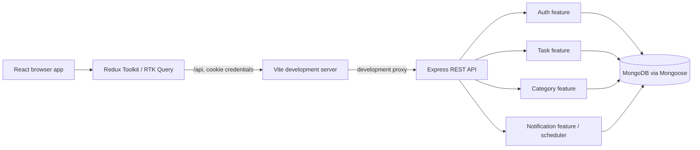

# Taskflow Architecture and Functionality

## 1. Purpose and current scope

Taskflow is a single-workspace-per-account todo application. Its architecture is split into a React client, a JSON REST API, and MongoDB persistence. Features are grouped by domain so that authentication, tasks, categories, and notifications can evolve independently.

This document describes what is implemented in this repository. It also calls out production features that are not implemented yet instead of implying they already exist.

## 2. System overview



In development, Vite serves the frontend on port `5173` and proxies `/api` requests to Express on port `5000`. Express connects to MongoDB before it starts listening. The reminder scheduler runs in the backend process and checks for due reminders every 30 seconds.

## 3. Technology stack

| Area | Technology | Responsibility |
|---|---|---|
| Browser UI | React and JavaScript | Forms, dashboard, task and category interactions |
| Client state and API cache | Redux Toolkit and RTK Query | Server requests, loading/error states, and cache invalidation |
| Development/build | Vite | Frontend development server and production bundle |
| API | Node.js and Express 5 | REST endpoints and middleware |
| Request validation | Zod | Validate and normalize request bodies, parameters, and query strings |
| Persistence | MongoDB and Mongoose | Schemas, indexes, queries, and model validation |
| Password hashing | bcryptjs | Store password hashes rather than passwords |
| Authentication | JSON Web Token in an HTTP-only cookie | Authenticate browser API requests |
| API protections | Helmet, CORS, express-rate-limit | Security headers, allowed client origin, and auth throttling |
| API documentation | OpenAPI 3.1 and Swagger UI | Interactive API reference at `/api/docs` |
| Tests | Node.js test runner | API, validation, and middleware checks |

## 4. Repository layout

### Backend

```text
backend/src/
  app.js                         Express middleware and route composition
  server.js                      Environment load, database connection, scheduler, HTTP listener
  config/
    env.js                       Required environment validation
    database.js                  Mongoose connection
  middleware/
    error-handler.js             Consistent JSON errors and database/validation error mapping
    not-found.js                 JSON 404 response
    require-auth.js              Required and optional cookie authentication
    validate.js                  Zod request validation
  features/
    auth/                        Registration, login, refresh/logout, User and Session models
    tasks/                       Task CRUD, filters, pagination, statistics, Task model
    categories/                  Category CRUD and Category model
    notifications/               Notification API, durable reminder-job queue and worker
    health/                      Service/database health endpoint
backend/test/
  api.test.js                    HTTP and request-validation tests
  integration.test.js            MongoDB-backed registration, ownership, CRUD and queue tests
backend/openapi.json             OpenAPI 3.1 contract served by Swagger UI
```

Each feature owns its routes, validation, controller/service behavior, and model where applicable. `app.js` composes features; `server.js` handles process startup.

### Frontend

```text
frontend/src/
  main.jsx                       React entry point and Redux Provider
  app/
    App.jsx                      Authenticated dashboard and application shell
    App.css                      Application and responsive styles
    store.js                     Redux store
    services/api.js              RTK Query endpoint definitions and cache tags
  features/
    auth/                        Login and registration UI
    tasks/                       Task list row and create/edit form
    categories/                  Category create/edit form
    notifications/               Notification panel and dismissal controls
  index.css                      Global styles
```

Feature components call RTK Query hooks rather than making API requests directly. Mutation tags invalidate relevant cached queries so task lists, statistics, categories, and notifications refresh after changes.

## 5. Data model

All records use MongoDB ObjectIds. Mongoose timestamps (`createdAt`, `updatedAt`) are enabled where appropriate.

### User

- `name`: required, trimmed, maximum 60 characters.
- `email`: required, unique, trimmed, stored lowercase.
- `passwordHash`: required and excluded from normal query results.

Passwords are hashed with bcrypt before persistence. The registration confirmation value is validated but never stored.
Account creation and starter-category creation run in one MongoDB transaction when supported by the connected deployment. On standalone MongoDB, the service uses compensating cleanup to remove any partially created categories and user if setup fails.

### Session

- User reference, SHA-256 hash of the current refresh token, and expiry timestamp.
- Refresh tokens are opaque random values stored only as hashes in MongoDB; an expiry TTL index removes expired records.
- Refresh rotates the stored hash atomically, making the previous refresh token unusable.

### Task

- Owner: required `user` reference.
- Content: required `title` (maximum 160 characters), optional `description` (maximum 2,000).
- Workflow: `status` is `todo`, `in-progress`, or `completed`.
- Organization: `priority` is `low`, `medium`, or `high`; optional category reference.
- Timing: optional `dueDate` and `reminderAt`.
- Validation requires a due date for a reminder, and the reminder time must not be later than the due date.

### Category

- Owner: required `user` reference.
- `name`: required, maximum 32 characters.
- `color`: validated six-digit hexadecimal color.
- Category names are unique per user. Deleting a category leaves its tasks intact and clears their category reference.

### Notification

- Owner and task references.
- `type`: `reminder` or `due`.
- Message/title, event time, and nullable `readAt`.
- A unique `(user, task, type)` index prevents duplicate reminder/due notifications for the same task.
- Dismissing a notification deletes it. Deleting or changing a task removes notifications associated with that task.

### ReminderJob

- User/task references, notification type, due timestamp, retry timestamp, attempt count, status, claim lease, and last error.
- Unique `(user, task, type)` index prevents duplicate jobs.
- Workers atomically claim due jobs with a lease; abandoned claims become eligible after lease expiry.
- Failed jobs retry with exponential backoff up to eight attempts, after which they remain in `failed` for inspection.

## 6. Authentication and request security

1. The browser submits registration or login over the same-origin `/api` path.
2. Registration validates the name, email, password, and matching `confirmPassword`; login validates email and password.
3. Passwords are hashed with bcrypt (12 rounds) before creating the user.
4. On successful registration/login, the server sets a signed 15-minute access JWT and a random seven-day refresh token in separate HTTP-only, `SameSite=Strict` cookies. The refresh token is stored as a hash in the Session collection. Cookies are `Secure` in production.
5. Protected routes verify the cookie and use the token subject as the authenticated user ID.
6. Database reads, updates, and deletes include the current user's ID, so one user cannot access another user's tasks, categories, or notifications by changing an object ID.
7. Login and registration are rate-limited. Helmet security headers and credentialed CORS are configured in the Express app.

The client retries one unauthorized request after rotating the refresh token. Logout revokes the current refresh session and clears both cookies. A stolen access token remains usable until its 15-minute expiry; refresh-token reuse is rejected. Password reset, email verification, and a user-facing all-device session-management screen are not implemented.

## 7. API conventions

- Base path: `/api`.
- Content type for JSON writes: `application/json`.
- Authenticated routes use the HTTP-only session cookie; the browser client sends credentials.
- Collections return JSON objects; list responses include pagination metadata.
- Invalid input returns HTTP `400` with an `error` and field-level `details`.
- Unauthenticated requests return `401`; missing resources return `404`; duplicate unique values return `409`.
- Successful create operations return `201`; delete/logout operations return `204`.

### Authentication

| Method | Route | Function |
|---|---|---|
| `POST` | `/api/auth/register` | Create account, seed starter categories, sign in |
| `POST` | `/api/auth/login` | Verify credentials and sign in |
| `POST` | `/api/auth/refresh` | Rotate refresh token and issue a new access token |
| `POST` | `/api/auth/logout` | Clear the browser auth cookie |
| `GET` | `/api/auth/me` | Return the current user or `{ "user": null }` |

### Tasks

| Method | Route | Function |
|---|---|---|
| `GET` | `/api/tasks` | List tasks with search, filters, sorting, and pagination |
| `POST` | `/api/tasks` | Create an owned task |
| `GET` | `/api/tasks/:id` | Read one owned task |
| `PATCH` | `/api/tasks/:id` | Update one or more validated fields |
| `DELETE` | `/api/tasks/:id` | Delete an owned task and its notifications |
| `GET` | `/api/tasks/statistics` | Return task counts, due-today/overdue totals, completion rate, and priority counts |

Task list query parameters:

| Parameter | Values | Default/limit |
|---|---|---|
| `page` | Positive integer | `1` |
| `limit` | Integer `1`–`100` | `10` |
| `search` | Text | Empty; maximum 100 characters |
| `status` | `todo`, `in-progress`, `completed` | No status filter |
| `priority` | `low`, `medium`, `high` | No priority filter |
| `category` | Category ObjectId or `uncategorized` | No category filter |
| `due` | `today`, `upcoming`, `overdue` | No due-date filter |
| `sort` | `createdAt`, `updatedAt`, `dueDate`, `priority`, `title` | `createdAt` |
| `order` | `asc`, `desc` | `desc` |
| `timezoneOffset` | Integer minutes from UTC, `-840`–`840` | `0` |

List response shape:

```json
{
  "data": [],
  "pagination": {
    "page": 1,
    "limit": 10,
    "total": 0,
    "pages": 0
  }
}
```

### Categories and notifications

| Method | Route | Function |
|---|---|---|
| `GET`, `POST` | `/api/categories` | List or create the current user's categories |
| `PATCH`, `DELETE` | `/api/categories/:id` | Update or delete an owned category |
| `GET` | `/api/notifications` | List up to 50 notifications and unread count |
| `PATCH` | `/api/notifications/:id/read` | Mark one owned notification as read |
| `PATCH` | `/api/notifications/read-all` | Mark all current user's notifications as read |
| `DELETE` | `/api/notifications/:id` | Dismiss one owned notification |
| `GET` | `/api/health` | Report API and MongoDB connection state |

Interactive API reference: `GET /api/docs`; machine-readable OpenAPI contract: `GET /api/docs/openapi.json`.

## 8. Functional workflows

### Account creation and sign-in

- User switches between sign-in and create-account forms.
- Registration requires matching passwords and returns inline mismatch feedback.
- On success, the session cookie is set and RTK Query refreshes the current-user query.
- The dashboard is shown only when `/api/auth/me` returns a user.

### Task management

- Create, edit, complete/reopen, and delete tasks.
- Assign status, priority, category, due date, and optional in-app reminder.
- Search title and description; filter by status, priority, category, due date, and completion.
- Change sort field and sort direction; move between server-paginated results.
- Dashboard statistics are invalidated and re-fetched after task mutations.

### Categories

- New accounts receive Personal, Work, Learning, and Health categories.
- Users can create, edit, and delete their own categories.
- Deleting a category does not delete associated tasks; those tasks become uncategorized.

### Reminders and notifications

- Backend scheduler checks due reminder and due-date timestamps every 30 seconds.
- The scheduler reconciles jobs from saved task timestamps on startup. MongoDB stores pending jobs, worker leases, retry times, and completion state, so jobs survive process restarts and multiple workers can claim jobs safely.
- Notifications are stored in MongoDB and deduplicated per task/type.
- The client polls notification data every 30 seconds.
- A notification can be marked read or dismissed with the × button.
- The notification panel closes on outside click, Escape, or its close button.

### Appearance

- Responsive layout supports desktop and narrow screens.
- Light/dark theme preference is stored in browser `localStorage`.

## 9. Validation and error handling

Each feature defines Zod schemas for request bodies, route parameters, and query parameters. The shared validation middleware:

1. Validates the request before the controller reaches business logic.
2. Supplies an empty object for a missing JSON body (required for GET requests).
3. Returns field paths and messages for invalid input.

Mongoose duplicate-key errors map to `409`; malformed JSON and schema/input errors map to `400`; unknown routes return JSON `404`; unexpected server failures are logged and return a generic `500` message.

## 10. Run locally

Prerequisites: Node.js 20+ and MongoDB Community Server (or a MongoDB Atlas URI).

1. From the repository root, copy `backend/.env.example` to `backend/.env`.
2. Set `MONGODB_URI` and generate a private JWT secret:

   ```powershell
   node -e "console.log(require('node:crypto').randomBytes(48).toString('hex'))"
   ```

3. Start the API in a terminal:

   ```powershell
   cd backend
   npm install
   npm run start:dev
   ```

4. Start the UI in another terminal:

   ```powershell
   cd frontend
   npm install
   npm run dev
   ```

5. Open `http://localhost:5173`. Check `http://localhost:5000/api/health` for database status.

Never commit `backend/.env` or expose its JWT secret.

## 11. Verification

```powershell
cd backend
npm test
npm run test:integration
```

```powershell
cd frontend
npm run build
npm run lint
```

The unit/API tests cover health responses, anonymous sessions, auth guards, JSON error handling, registration/password validation, reminder validation, pagination boundaries, missing GET bodies, and the OpenAPI/Swagger routes. Integration tests cover failed registration cleanup, category/task CRUD, user ownership, notification read/dismiss behavior, session rotation/revocation, and recovery of an expired reminder-job claim. They connect to `MONGODB_TEST_URI` (or `MONGODB_URI`, falling back to local MongoDB), use a uniquely named temporary database, and drop that test database when finished.

## 12. Planned production work

These are not currently delivered by the repository:

- Password reset, email verification, account recovery, and device/session management.
- Automated browser end-to-end testing and a Postman collection.
- Dead-letter job administration and alerting for reminder jobs that exhaust retries.
- Docker/production deployment, CI/CD workflows, production log aggregation, and error monitoring.
- Automated database backups and a documented production data-retention policy.
